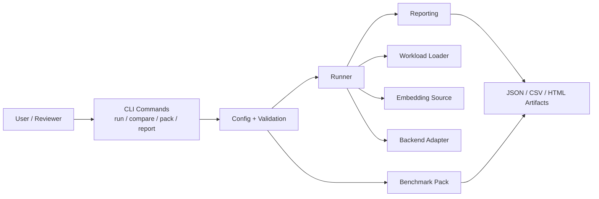
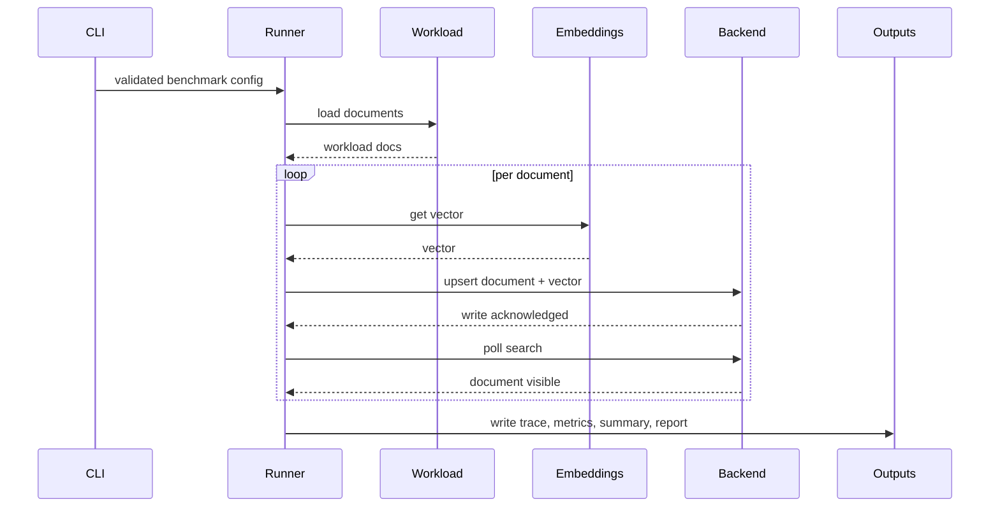
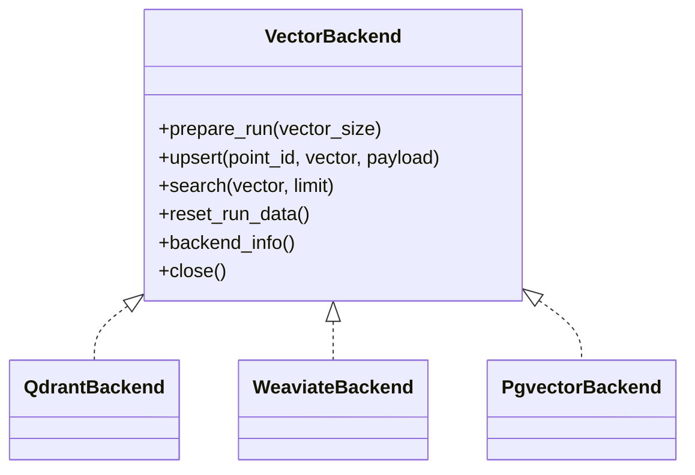

# Architecture Document

- Project: Freshness Benchmark
- Date: March 26, 2026
- Status: Architecture stable, final polish remaining

## Overview

Freshness Benchmark is a Python CLI that measures how long it takes for a document to become searchable after submission. The design keeps execution logic separate from backend adapters, workload loading, and report generation so the benchmark stays repeatable and easy to review.

## High-Level Architecture

## Runtime Flow

## Main Components

- `CLI`
  Parses commands and routes to `run`, `compare`, `pack`, or `report`.
- `Config`
  Validates inputs such as backend, rate, dataset options, and output paths.
- `Workload Loader`
  Produces synthetic or dataset-backed documents and injects deterministic retrieval anchors for dataset runs.
- `Embedding Source`
  Supports `precomputed` mode for fairness and `live` mode for end-to-end timing.
- `Backend Adapter`
  Hides Qdrant, Weaviate, and pgvector specifics behind a common contract.
- `Reporting`
  Converts lifecycle records into JSON, CSV, and HTML outputs.

## Backend Abstraction

## Key Design Choices

- `precomputed` mode removes embedding-provider latency from backend comparisons.
- Dataset runs inject retrieval anchors so search success is deterministic.
- The runner uses separate embedding, write, and search stages so later documents can progress while earlier ones are still waiting for visibility.
- Artifacts are written per run to keep the benchmark auditable and review-friendly.

## Outputs

- Single run: `trace.jsonl`, `metrics.csv`, `summary.json`, `report.html`
- Compare: `comparison.json`, `comparison.csv`, `comparison.html`
- Pack: `benchmark_pack.json`, `benchmark_pack.csv`, `benchmark_pack.html`

## Current Status

The architecture is complete for the intended scope. Remaining work is limited to report polish, wider smoke validation, and review packaging.
