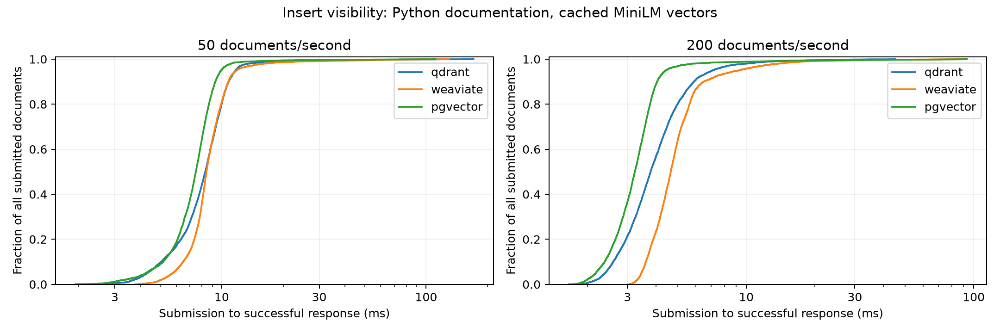

# Freshness Benchmark: insert visibility v1

This experiment measures the first successful self-vector search response after submission. It is an observation upper bound, including client queues, transport and query time. Negative ANN probes do not establish absence.

Scope: local single-node Docker, Python 3.13 documentation, 384-dimensional cached MiniLM vectors, collection-wide cosine search, top-10, 2,000 preloaded records, 1,000 measured inserts per trial. Resource limits: 2 CPUs and 2 GiB per backend. No claim about semantic relevance, durability equivalence, distributed operation, updates/deletes, or large production indexes.

| Backend | Docs/s | Trials | Success | Median trial p50 ms | Median trial p95 ms | 95% interval for median p95 | ≤100ms / all submissions | Schedule / probe gates |
|---|---:|---:|---:|---:|---:|---|---:|---|
| pgvector | 50 | 5 | 100.00% | 7.39 | 10.04 | [9.78, 10.06] | 99.96% | True / True |
| pgvector | 200 | 5 | 100.00% | 3.32 | 4.29 | [4.03, 4.71] | 100.00% | True / True |
| qdrant | 50 | 5 | 100.00% | 8.43 | 11.64 | [11.55, 11.90] | 99.88% | True / True |
| qdrant | 200 | 5 | 100.00% | 3.52 | 7.25 | [5.74, 8.47] | 100.00% | True / True |
| weaviate | 50 | 5 | 100.00% | 8.46 | 11.24 | [11.05, 23.87] | 99.92% | True / True |
| weaviate | 200 | 5 | 100.00% | 4.74 | 7.30 | [6.46, 13.15] | 100.00% | True / True |

Intervals use 10,000 seeded bootstrap resamples of independent trial p95 values, followed by the median. Five trials give limited uncertainty resolution. CDFs pool observations descriptively; failures remain in the denominator. No significance or universal winner is asserted.

Arrival gate: each trial’s p95 scheduling delay must be ≤ one requested interarrival interval. Probe gate: each trial’s p95 first-probe queue must be ≤10ms. A failed gate limits backend-specific interpretation; all results are retained. A successful first probe provides no estimate of visibility before that response.

Completed 30 of 30 planned runs. See results.csv, experiment.json, each run’s summary.json/trace.jsonl, and checksums.json for audit evidence.
