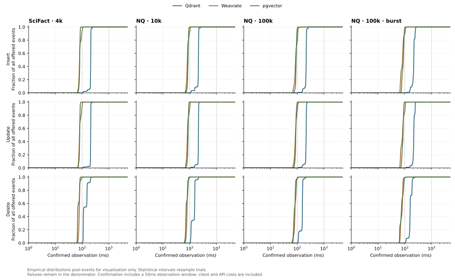

# Protocol 2 reference results

60/60 planned trials completed; 0 setup failures. 19,350 offered mutations; 19,350 confirmed successfully.

This is the single-host reference for a public benchmark protocol, not a universal product ranking. The [methodology](https://github.com/aadithya2112/freshness-benchmark/blob/v0.5.0/methodology.md) defines the clock, quality cohort, failure handling, and limits.

Host: Apple M4. Each container: 2 CPUs / 3 GiB. Five trials per cell, 30s admission, 10 mutations/s and 10 real-question queries/s. Burst windows offer 40 mutations/s for 1s every 10s. Observation reads add load.

## Per-workload comparisons

Times are medians of trial p95s. Intervals are 95% bootstrap intervals over five trials. Latencies condition on successful events; success and SLO fractions use all offered mutations. “Limited” means at least one validity check failed; inspect the evidence before comparing that cell.

| Workload | Engine | Change | Events | Confirmed | First p95 [95% CI], ms | Confirmed p95 [95% CI], ms | Within 100ms | ANN recall | Validity |
|---|---|---|---:|---:|---:|---:|---:|---:|---|
| nq-100k | pgvector | insert | 500 | 100.0% | 35.70 [34.60, 36.61] | 97.73 [96.78, 101.73] | 97.6% | 99.4% | Pass |
| nq-100k | pgvector | update | 500 | 100.0% | 33.68 [33.08, 34.44] | 95.31 [94.33, 96.57] | 99.4% | 99.4% | Pass |
| nq-100k | pgvector | delete | 500 | 100.0% | 31.24 [29.92, 31.79] | 95.18 [94.01, 97.07] | 98.4% | 99.4% | Pass |
| nq-100k | Qdrant | insert | 500 | 100.0% | 72.88 [72.11, 105.24] | 222.88 [218.98, 233.10] | 0.0% | 98.9% | Pass |
| nq-100k | Qdrant | update | 500 | 100.0% | 71.59 [70.96, 74.28] | 222.30 [221.13, 224.43] | 0.0% | 98.9% | Pass |
| nq-100k | Qdrant | delete | 500 | 100.0% | 21.21 [20.73, 48.00] | 161.32 [159.60, 181.21] | 0.0% | 98.9% | Pass |
| nq-100k | Weaviate | insert | 500 | 100.0% | 34.05 [32.88, 35.35] | 106.31 [105.18, 106.85] | 78.6% | 99.1% | Pass |
| nq-100k | Weaviate | update | 500 | 100.0% | 32.31 [30.47, 33.66] | 104.01 [103.17, 106.19] | 86.2% | 99.1% | Pass |
| nq-100k | Weaviate | delete | 500 | 100.0% | 20.26 [20.21, 25.11] | 87.69 [86.34, 94.06] | 97.8% | 99.1% | Pass |
| nq-100k-burst | pgvector | insert | 650 | 100.0% | 34.40 [33.21, 35.77] | 96.82 [95.13, 97.59] | 98.8% | 99.4% | Pass |
| nq-100k-burst | pgvector | update | 650 | 100.0% | 30.92 [30.47, 31.77] | 92.13 [91.93, 93.06] | 100.0% | 99.4% | Pass |
| nq-100k-burst | pgvector | delete | 650 | 100.0% | 29.48 [28.83, 30.60] | 93.76 [91.42, 94.38] | 99.2% | 99.4% | Pass |
| nq-100k-burst | Qdrant | insert | 650 | 100.0% | 105.21 [103.73, 106.36] | 246.85 [243.33, 251.60] | 0.0% | 99.1% | Pass |
| nq-100k-burst | Qdrant | update | 650 | 100.0% | 102.87 [102.69, 104.75] | 244.15 [243.98, 248.61] | 0.0% | 99.1% | Pass |
| nq-100k-burst | Qdrant | delete | 650 | 100.0% | 48.00 [46.64, 51.41] | 189.80 [187.99, 201.18] | 0.0% | 99.1% | Pass |
| nq-100k-burst | Weaviate | insert | 650 | 100.0% | 31.98 [31.26, 32.53] | 104.36 [103.55, 105.73] | 90.0% | 99.1% | Pass |
| nq-100k-burst | Weaviate | update | 650 | 100.0% | 32.94 [32.39, 33.67] | 104.62 [103.40, 105.57] | 86.5% | 99.1% | Pass |
| nq-100k-burst | Weaviate | delete | 650 | 100.0% | 19.06 [18.52, 20.84] | 86.67 [85.46, 87.09] | 99.1% | 99.1% | Pass |
| nq-10k | pgvector | insert | 500 | 100.0% | 25.95 [25.32, 28.12] | 91.48 [89.20, 94.82] | 99.4% | 99.9% | Pass |
| nq-10k | pgvector | update | 500 | 100.0% | 25.99 [25.76, 26.79] | 91.28 [90.41, 93.34] | 100.0% | 99.9% | Pass |
| nq-10k | pgvector | delete | 500 | 100.0% | 24.24 [23.48, 25.06] | 89.96 [87.45, 90.41] | 100.0% | 99.9% | Pass |
| nq-10k | Qdrant | insert | 500 | 100.0% | 71.66 [70.81, 80.69] | 218.27 [216.65, 219.56] | 0.0% | 99.9% | Pass |
| nq-10k | Qdrant | update | 500 | 100.0% | 69.55 [69.17, 70.78] | 216.61 [216.20, 219.40] | 0.0% | 99.9% | Pass |
| nq-10k | Qdrant | delete | 500 | 100.0% | 23.39 [21.05, 59.27] | 159.07 [157.74, 203.17] | 0.0% | 99.9% | Pass |
| nq-10k | Weaviate | insert | 500 | 100.0% | 30.46 [30.21, 31.55] | 103.43 [98.08, 103.88] | 93.4% | 99.6% | Pass |
| nq-10k | Weaviate | update | 500 | 100.0% | 31.65 [29.87, 34.30] | 103.15 [98.48, 103.84] | 91.4% | 99.6% | Pass |
| nq-10k | Weaviate | delete | 500 | 100.0% | 21.34 [19.99, 26.37] | 86.33 [84.78, 93.39] | 99.4% | 99.6% | Pass |
| scifact-small | pgvector | insert | 500 | 100.0% | 23.14 [22.38, 25.18] | 85.26 [83.68, 86.06] | 100.0% | 99.9% | Pass |
| scifact-small | pgvector | update | 500 | 100.0% | 22.38 [22.24, 23.85] | 84.72 [84.27, 85.31] | 99.8% | 99.9% | Pass |
| scifact-small | pgvector | delete | 500 | 100.0% | 21.36 [21.18, 22.03] | 82.70 [81.88, 83.92] | 100.0% | 99.9% | Pass |
| scifact-small | Qdrant | insert | 500 | 100.0% | 104.41 [69.96, 104.77] | 213.81 [211.83, 217.68] | 0.0% | 100.0% | Pass |
| scifact-small | Qdrant | update | 500 | 100.0% | 67.50 [65.92, 75.39] | 212.79 [211.28, 213.29] | 0.0% | 100.0% | Pass |
| scifact-small | Qdrant | delete | 500 | 100.0% | 60.77 [58.19, 63.43] | 204.85 [198.76, 205.95] | 0.0% | 100.0% | Pass |
| scifact-small | Weaviate | insert | 500 | 100.0% | 30.85 [29.90, 31.53] | 102.79 [96.51, 103.17] | 94.2% | 100.0% | Pass |
| scifact-small | Weaviate | update | 500 | 100.0% | 30.45 [28.83, 32.10] | 102.80 [96.14, 103.50] | 95.0% | 100.0% | Pass |
| scifact-small | Weaviate | delete | 500 | 100.0% | 24.42 [20.77, 25.02] | 88.76 [82.90, 91.46] | 99.6% | 100.0% | Pass |

## Retrieval during mutations

Each trial sends 300 real-question queries to the immutable cohort in the same changing index. The idle baseline uses 100 queries before mutation admission. Times are medians of trial p95s; loaded intervals resample whole trials. ANN recall measures approximation quality, while nDCG measures agreement with relevance judgments. These are subset scores, not full BEIR scores.

| Workload | Engine | Successful queries | Idle p95, ms | Loaded p95 [95% CI], ms | ANN recall@10 | nDCG@10 | Exact nDCG@10 |
|---|---|---:|---:|---:|---:|---:|---:|
| nq-100k | pgvector | 1500/1500 | 22.15 | 15.80 [14.82, 16.51] | 99.4% | 0.79 | 0.79 |
| nq-100k | Qdrant | 1500/1500 | 12.68 | 12.26 [11.14, 47.88] | 98.9% | 0.79 | 0.79 |
| nq-100k | Weaviate | 1500/1500 | 13.48 | 16.00 [14.93, 16.25] | 99.1% | 0.79 | 0.79 |
| nq-100k-burst | pgvector | 1500/1500 | 22.10 | 14.71 [14.26, 15.09] | 99.4% | 0.79 | 0.79 |
| nq-100k-burst | Qdrant | 1500/1500 | 11.26 | 48.03 [47.13, 49.62] | 99.1% | 0.79 | 0.79 |
| nq-100k-burst | Weaviate | 1500/1500 | 13.23 | 15.97 [14.80, 16.30] | 99.1% | 0.79 | 0.79 |
| nq-10k | pgvector | 1500/1500 | 8.94 | 7.82 [6.98, 8.23] | 99.9% | 0.95 | 0.95 |
| nq-10k | Qdrant | 1500/1500 | 9.78 | 11.17 [10.66, 15.28] | 99.9% | 0.95 | 0.95 |
| nq-10k | Weaviate | 1500/1500 | 12.61 | 14.89 [14.26, 15.59] | 99.6% | 0.95 | 0.95 |
| scifact-small | pgvector | 1500/1500 | 7.32 | 6.18 [5.79, 6.38] | 99.9% | 0.66 | 0.66 |
| scifact-small | Qdrant | 1500/1500 | 8.48 | 10.31 [9.49, 45.82] | 100.0% | 0.66 | 0.66 |
| scifact-small | Weaviate | 1500/1500 | 12.13 | 14.37 [13.32, 15.72] | 100.0% | 0.66 | 0.66 |

## Provenance and interpretation

All trials and failed gates are preserved in `results.json`; raw traces are in the complete evidence download. The verifier reconstructs confirmations and metrics from probes and queries. The exact source at launch, data/model hashes, images, effective index configuration, CPU/throttling counters, and randomized order accompany the results.

The fixed embedding model, relevant-first subset selection, filtered immutable quality cohort, simulated disjoint-ID mutations, short trials, shared Docker host, backend-specific transports, and acknowledgement semantics bound the claims. There is no historical replay, distributed consistency test, independent external replication, or maximum-throughput measurement here.

Higher-rate diagnostic pilots and the interrupted boundary-scheduling audit are separate artifacts. They did not contribute observations to this reference matrix.

## Continuation history

1 partial attempt was interrupted by the host/session and retained under `continuations/`. The first six completed trials were kept, the environment and measurement-source hashes were checked, calibration was repeated, and the partial seventh trial was restarted from a fresh collection. This interruption is excluded from database reliability statistics because it lacks a terminal measurement record. Raw partial probes and continuation metadata remain in the evidence bundle. Container restart/cache-state differences are an additional limitation.

A user-requested pause followed 44 completed trials at a clean boundary. Containers were stopped and later restarted; environment and source checks and calibration were repeated before continuing. No completed trial was replaced.
